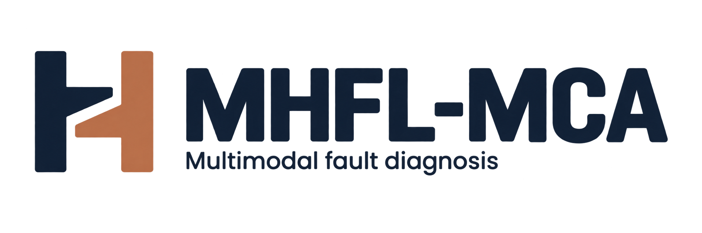

<a id="top"></a>

<p align="center">
  <picture>
    <source media="(prefers-color-scheme: dark)" srcset="assets/mhfl-mca-banner-dark-v3.png" />
    
  </picture>
</p>

<p align="center">
  <a href="https://github.com/yazyeah/MHFL-MCA-Codes-Datasets-and-Results/stargazers"></a>
  <a href="LICENSE_SCOPE.md"></a>
  <a href="https://github.com/yazyeah/MHFL-MCA-Codes-Datasets-and-Results/commits"></a>
  <a href="https://github.com/yazyeah/MHFL-MCA-Codes-Datasets-and-Results/pulls"></a>
  <a href="ENVIRONMENT.md"></a>
  <a href="https://github.com/yazyeah/MHFL-MCA-Codes-Datasets-and-Results/actions/workflows/repository-audit.yml"></a>
  <a href="https://deepwiki.com/yazyeah/MHFL-MCA-Codes-Datasets-and-Results"></a>
</p>

<p align="center">
  <a href="Readme.md">中文</a> | English
</p>

- MHFL-MCA addresses bearing fault diagnosis with limited labeled samples, changing loads and measurement noise.
- The repository provides the TensorFlow/Keras implementation, comparison methods, experimental results and supplementary experiments accompanying the paper.
- The UO experiments pair vibration with acoustic signals; the KAIST experiments pair vibration with motor-current signals. Each input segment contains 2048 points.
- Modality-specific encoders, bidirectional cross-attention and sample-dependent modality weights form the feature learning and fusion pipeline.
- Evaluation includes five deep comparison methods, ablations, noise tests and missing-modality tests. Data and result figures use Git LFS, with selective downloads for each experiment.

> Author-owned code and documentation are released under MIT. Dataset licenses are listed in [DATA_LICENSES.md](DATA_LICENSES.md). Checkpoint manifests are available; trained weights have not been publicly released.

<p align="center">
  <a href="https://doi.org/10.1016/j.aei.2026.105277">Paper</a> |
  <a href="#method">Method</a> |
  <a href="#quick-start">Quick start</a> |
  <a href="#datasets">Datasets and experiments</a> |
  <a href="#results">Results</a> |
  <a href="https://deepwiki.com/yazyeah/MHFL-MCA-Codes-Datasets-and-Results">DeepWiki</a>
</p>

---

<a id="introduction"></a>

# 📌 Introduction

Paired sensor signals provide complementary measurements of machine health. MHFL-MCA uses separate convolutional encoders to learn their features, bidirectional cross-attention to model interactions between modalities, and adaptive modality reweighting to combine the features for fault classification. The experiments examine limited training data and differences between training and test conditions.

The method is described in [*Multimodal heterogeneous feature learning with modality-cross-attention for robust fault diagnosis of machines under complex conditions*](https://doi.org/10.1016/j.aei.2026.105277), published in *Advanced Engineering Informatics*.

For each sample $i$, MHFL-MCA takes two paired 1-D signal segments, each with 2048 points.

The Modality-Specific Heterogeneous Encoder Module (MSHEM) extracts features with different convolution kernels, activations and pooling operations. The Cross-Attention Interaction Module (CAIM) exchanges these features in both directions. The Adaptive Modality Re-Weighting Module (AMRM) learns relative weights to combine them, and the Fusion Classification Block (FCB) predicts the health state.

<a id="method"></a>

## Method

The framework consists of heterogeneous encoding, bidirectional interaction, modality reweighting and classification. Modality 1 is vibration; modality 2 is acoustic for UO or motor current for KAIST.

<p align="center">
  
</p>

### 1. Heterogeneous feature encoding (MSHEM)

For sample $i$, the paired inputs are $\mathbf{x}_i^{(1)},\mathbf{x}_i^{(2)}\in\mathbb{R}^{2048}$. Independently parameterized encoders produce modality-specific feature maps:

```math
F_i^{(m)}=E_m(\mathbf{x}_i^{(m)};\theta_m)
\in\mathbb{R}^{T_m\times C_m},\qquad m\in\{1,2\}.
```

$T_m$ and $C_m$ denote temporal length and channel count. The vibration branch uses kernel size 16, LeakyReLU and average pooling. The acoustic or current branch uses kernel size 8, GELU and max pooling.

### 2. Bidirectional cross-attention (CAIM)

In direction $a\leftarrow b$, modality $a$ supplies the queries and modality $b$ supplies the keys and values, with $`a,b\in\{1,2\}`$ and $a\ne b$. Each direction has its own projection parameters:

```math
\begin{aligned}
Q_i^{a\leftarrow b}&=F_i^{(a)}W_q^{a\leftarrow b},\\
K_i^{a\leftarrow b}&=F_i^{(b)}W_k^{a\leftarrow b},\qquad
V_i^{a\leftarrow b}=F_i^{(b)}W_v^{a\leftarrow b},\\
G_i^{a\leftarrow b}&=\mathrm{softmax}_{\mathrm{row}}
\!\left(Q_i^{a\leftarrow b}(K_i^{a\leftarrow b})^\top\right)
V_i^{a\leftarrow b},\qquad a\ne b.
\end{aligned}
```

Softmax acts along the key's temporal dimension, allowing each query position to aggregate information from the other modality. The outputs $G_i^{1\leftarrow2}$ and $G_i^{2\leftarrow1}$ have shapes $T_1\times D$ and $T_2\times D$, where $D$ is the attention projection dimension.

### 3. Modality reweighting and fusion (AMRM)

The flattened interaction features produce separate Sigmoid scores. A two-output dense layer followed by Softmax converts these scores into sample-dependent modality weights:

```math
\begin{aligned}
g_i^{(1)}&=\mathrm{vec}(G_i^{1\leftarrow2}),\qquad
g_i^{(2)}=\mathrm{vec}(G_i^{2\leftarrow1}),\\
s_i^{(m)}&=\sigma(w_m^\top g_i^{(m)}+b_m),\\
\boldsymbol{\alpha}_i&=\mathrm{softmax}
\!\left(W_s[s_i^{(1)};s_i^{(2)}]+b_s\right).
\end{aligned}
```

The weights satisfy $\alpha_i^{(1)}+\alpha_i^{(2)}=1$. The fusion vector concatenates the two weighted features:

```math
z_i=[\,\alpha_i^{(1)}g_i^{(1)};\ \alpha_i^{(2)}g_i^{(2)}\,]
\in\mathbb{R}^{(T_1+T_2)D}.
```

$`[\,\cdot\,;\,\cdot\,]`$ denotes vector concatenation and $`\sigma`$ denotes Sigmoid. Both interaction features contribute to the weight assigned to each modality.

### 4. Health-state classification (FCB)

A 256-dimensional hidden layer with LeakyReLU maps the fused vector to a representation used by the Softmax classifier. The base supervised objective is cross-entropy over $K$ health states:

```math
\begin{aligned}
p_i&=\mathrm{softmax}\!\left(
W_c\mathrm{LeakyReLU}(W_fz_i+b_f)+b_c\right),\\
\mathcal{L}_{\mathrm{CE}}&=-\frac{1}{M}
\sum_{i=1}^{M}\sum_{k=1}^{K}y_{ik}\log p_{ik}.
\end{aligned}
```

$M$ is the batch size, $`y_{ik}`$ is the $k$-th component of the one-hot label and $`p_{ik}`$ is the predicted probability. KAIST noise-stable training also includes a KL consistency term, as specified in [MHCNN_KAIST.py](Codes/Codes%20for%20KAIST/MHCNN_KAIST.py). These equations describe `CrossAttention` and `create_model` in the main implementations: [UO](Codes/Codes%20for%20UO/MHCNN_UO.py) | [KAIST](Codes/Codes%20for%20KAIST/MHCNN_KAIST.py).

[DeepWiki](https://deepwiki.com/yazyeah/MHFL-MCA-Codes-Datasets-and-Results) provides an online index of the code modules, data pipeline and experiment entry points.

The main implementations are [MHCNN_UO.py](Codes/Codes%20for%20UO/MHCNN_UO.py) and [MHCNN_KAIST.py](Codes/Codes%20for%20KAIST/MHCNN_KAIST.py). The scripts implement MHFL-MCA and retain the historical `MHCNN` filenames.

---

<a id="quick-start"></a>

# 📌 Quick start

Requirements: Git, [Git LFS](https://git-lfs.com/) and Conda. The commands use Windows PowerShell or Conda PowerShell; commands after cloning run from the repository root.

The experimental environment uses Python 3.9.20 and TensorFlow/Keras 2.7.0. Dependencies: [ENVIRONMENT.md](ENVIRONMENT.md) | GPU configuration: [HARDWARE.md](HARDWARE.md).

## Step 0: Clone the repository

Clone without automatically downloading large LFS files:

```powershell
git lfs install
$env:GIT_LFS_SKIP_SMUDGE = '1'
git -c core.longpaths=true clone https://github.com/yazyeah/MHFL-MCA-Codes-Datasets-and-Results.git
Set-Location .\MHFL-MCA-Codes-Datasets-and-Results
git config core.longpaths true
Remove-Item Env:GIT_LFS_SKIP_SMUDGE -ErrorAction SilentlyContinue
```

## Step 1: Create the environment

```powershell
conda env create -f environment.yml
conda activate mhfl-mca-revision
$env:PYTHONNOUSERSITE = '1'
$env:PYTHONDONTWRITEBYTECODE = '1'
python -m pip check
python tools\verify_repository_contract.py
```

The repository audit validates required files and settings. It does not run model training.

## Step 2: Download data

Download the required dataset:

```powershell
# UO: MATLAB files used by the experiments
git lfs pull --include="Datasets/UO/3_MatLab_Raw_Data/**" --exclude=""

# KAIST: vibration and current files
git lfs pull --include="Datasets/KAIST/**" --exclude=""
```

Downloaded files can be validated using the procedure in [DATA.md](DATA.md). Training requires the actual sensor data; unresolved Git LFS pointers contain only file metadata.

## Step 3: Configure paths and run

Configure the selected script's `YOUR_*` paths for the local data, output and temporary directories. KAIST runs also require matching the loader's channel selection to the physical sensor channels.

```powershell
# UO main experiment
python "Codes/Codes for UO/MHCNN_UO.py"

# KAIST main experiment
python "Codes/Codes for KAIST/MHCNN_KAIST.py"
```

Supplementary experiments have separate configurations and run commands: [REPRODUCIBILITY.md](REPRODUCIBILITY.md) | [Supplementary README](MHFL-MCA%20Supplementary%20Experiments/README.md).

<details>
<summary>Sensor channels, checkpoints and reproduction limits</summary>

The KAIST supplementary suite selects current channel `cDAQ9185-1F486B5Mod2/ai0` from TDMS group `Log`, and zero-based vibration column `0`.

The original KAIST script selects zero-based vibration column `1` when the vibration array has at least five columns. If it cannot identify the U-phase current channel, it falls back to the channel with the largest variance. The selection logic is implemented in `_pick_vib_1d` and `read_current_1d_from_tdms`. Comparisons between the original and supplementary pipelines require consistent channel selection; the supplementary suite's channel environment variables do not control the original script.

Checkpoint manifests and SHA-256 checksums are listed in [MODEL_ZOO.md](MODEL_ZOO.md). Trained weights have not been publicly released; model reproduction requires training with the documented commands.

The data audit validates source files without rerunning training. The historical initializer and random streams were not fully recorded, so byte-for-byte weight reproduction is not guaranteed. Experiment 05 combines selected main-paper references with a controlled extension; the source mapping is recorded in [REPRODUCIBILITY.md](REPRODUCIBILITY.md).

Architecture and supplementary figures: `git lfs pull --include="MHFL-MCA Supplementary Experiments/**" --exclude=""`.

</details>

---

<a id="datasets"></a>

# 📌 Datasets and experiments

The paper evaluates MHFL-MCA on two public datasets.

| Dataset | Modalities used | Task | Repository files |
| :--- | :--- | :--- | :--- |
| UO / UORED-VAFCLS | Vibration + acoustic | Seven health states; limited training samples | 60 recordings, each in CSV, XLSX and MAT formats. |
| KAIST | Vibration + current | Five health states; train and validate at 0 Nm, test at 2 and 4 Nm | 15 vibration MAT files and 15 current TDMS files. |

Official sources: [UO](https://data.mendeley.com/datasets/y2px5tg92h) | [KAIST v6](https://data.mendeley.com/datasets/ztmf3m7h5x/6).

The KAIST files are a selected subset of the upstream dataset. The exact upstream version of the included UO files is **UNCONFIRMED**. Dataset provenance and attribution: [DATA.md](DATA.md) | [DATA_LICENSES.md](DATA_LICENSES.md).

The Git LFS inventory contains approximately 0.282 GiB of UO MATLAB files and 2.027 GiB of KAIST vibration/current files. All LFS objects, including historical results, total approximately 8.858 GiB.

## Experiment guide

Main implementations: [UO](Codes/Codes%20for%20UO/) | [KAIST](Codes/Codes%20for%20KAIST/). Original experimental results, learning curves and confusion matrices: [Results](Results/).

| Supplementary experiment | Results and notes |
| :--- | :--- |
| Modality weights and missing modalities | [Experiment 02](MHFL-MCA%20Supplementary%20Experiments/Results/Revision%20Experiments/full_20260807_r1/02_Modality_Weights_and_Missing/README.md) |
| Parameters, FLOPs and inference efficiency | [Experiment 03](MHFL-MCA%20Supplementary%20Experiments/Results/Revision%20Experiments/full_20260807_r1/03_Efficiency_Profile/README.md) |
| Controlled ablations | [Experiment 04](MHFL-MCA%20Supplementary%20Experiments/Results/Revision%20Experiments/full_20260807_r1/04_Additional_Controlled_Ablation/README.md) |
| Extreme low-shot analysis | [Experiment 05](MHFL-MCA%20Supplementary%20Experiments/Results/Revision%20Experiments/full_20260807_r1/05_Extreme_Lowshot_CAIM/README.md) |
| Traditional TF-SVM comparisons | [Experiment 06](MHFL-MCA%20Supplementary%20Experiments/Results/Revision%20Experiments/full_20260807_r1/06_Traditional_Baselines/README.md) |

Run configurations and commands: [Reproduction guide](REPRODUCIBILITY.md) | [Supplementary experiments](MHFL-MCA%20Supplementary%20Experiments/README.md). Hardware and measurement scope: [HARDWARE.md](HARDWARE.md).

---

<a id="results"></a>

# 📈 Results

Classification accuracy with five training samples per class (N = 5):

| Method | UO | KAIST: 0 → 2 Nm | KAIST: 0 → 4 Nm |
| :--- | ---: | ---: | ---: |
| MRCFN | 65.21 ± 7.88 | 59.29 ± 4.46 | 53.84 ± 5.68 |
| CFFN | 76.83 ± 5.79 | 58.29 ± 4.18 | 52.80 ± 5.36 |
| CDTFAFN | 62.37 ± 7.60 | 65.32 ± 3.36 | 57.74 ± 5.08 |
| MSF-DFormer | 72.87 ± 6.54 | 74.55 ± 4.31 | 78.62 ± 4.66 |
| KDCNN-DF | 75.32 ± 2.82 | 64.27 ± 4.38 | 57.36 ± 5.44 |
| **MHFL-MCA** | **92.79 ± 2.88** | **97.39 ± 1.95** | **91.56 ± 8.32** |

Accuracy is in percent. For each metric, the highest and lowest values from 10 runs are removed; the remaining eight give the mean ± standard deviation. UO uses raw vibration and acoustic segments. KAIST trains at 0 Nm and tests at 2 or 4 Nm with the 0 dB baseline noise setting.

Sources: main-paper Tables 5, 9 and 10 | [Reference values and protocols](MHFL-MCA%20Supplementary%20Experiments/Codes/Revision%20Experiments/configs/main_manuscript_deep_reference.json) | [Value checks](MHFL-MCA%20Supplementary%20Experiments/Provenance/audits/ARTIFACT_VALUE_VERIFICATION.md).

<details>
<summary>Statistical scope</summary>

Per-seed values are unavailable for these aggregate reference results, which cannot support paired tests or statistical-significance claims. Results for other sample sizes, noise conditions and ablations are listed in the [experiment guide](#datasets). Result sources are recorded in the [provenance records](MHFL-MCA%20Supplementary%20Experiments/Provenance/README.md).

</details>

---

<a id="citation"></a>

# 🎓 Citation

For research using MHFL-MCA or the experimental results, cite:

Yuang Zhou, Tianci Zhang, Tongyang Pan, Jingsong Xie, Jinglong Chen. **Multimodal heterogeneous feature learning with modality-cross-attention for robust fault diagnosis of machines under complex conditions.** *Advanced Engineering Informatics*, 77, 105277, 2027. [DOI: 10.1016/j.aei.2026.105277](https://doi.org/10.1016/j.aei.2026.105277).

```bibtex
@article{zhou2027mhflmca,
  title   = {Multimodal heterogeneous feature learning with modality-cross-attention for robust fault diagnosis of machines under complex conditions},
  author  = {Zhou, Yuang and Zhang, Tianci and Pan, Tongyang and Xie, Jingsong and Chen, Jinglong},
  journal = {Advanced Engineering Informatics},
  volume  = {77},
  pages   = {105277},
  year    = {2027},
  doi     = {10.1016/j.aei.2026.105277}
}
```

The experiments use public data released by the University of Ottawa and KAIST dataset authors. Dataset citations and attribution requirements: [DATA_LICENSES.md](DATA_LICENSES.md).

---

# License

Author-owned code and documentation use the [MIT License](LICENSE). Third-party datasets retain their upstream licenses and attribution requirements: [Dataset licenses](DATA_LICENSES.md) | [Third-party notices](THIRD_PARTY_NOTICES.md) | [License scope](LICENSE_SCOPE.md).

Reproduction issues: [Issues](https://github.com/yazyeah/MHFL-MCA-Codes-Datasets-and-Results/issues). Reports should include the commit, environment versions, command and relevant logs. Documentation and code fixes can be submitted as [pull requests](https://github.com/yazyeah/MHFL-MCA-Codes-Datasets-and-Results/pulls). Changes to experimental settings should describe their effect on result comparability.

<p align="center">
  <a href="Readme.md">中文</a> | <a href="#top">Back to top</a>
</p>
